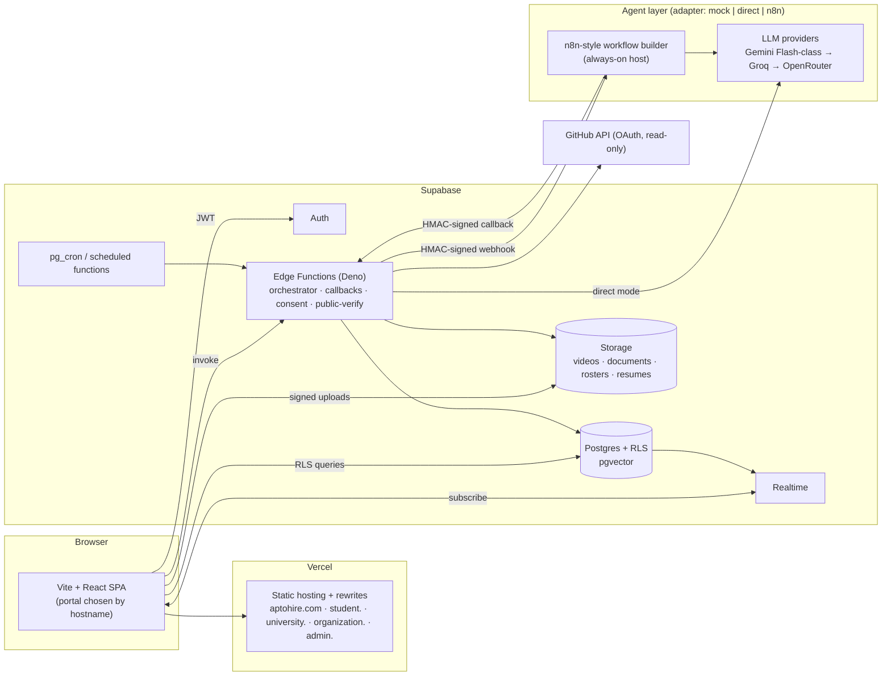
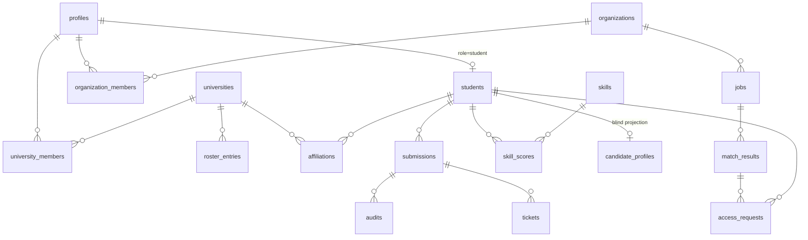
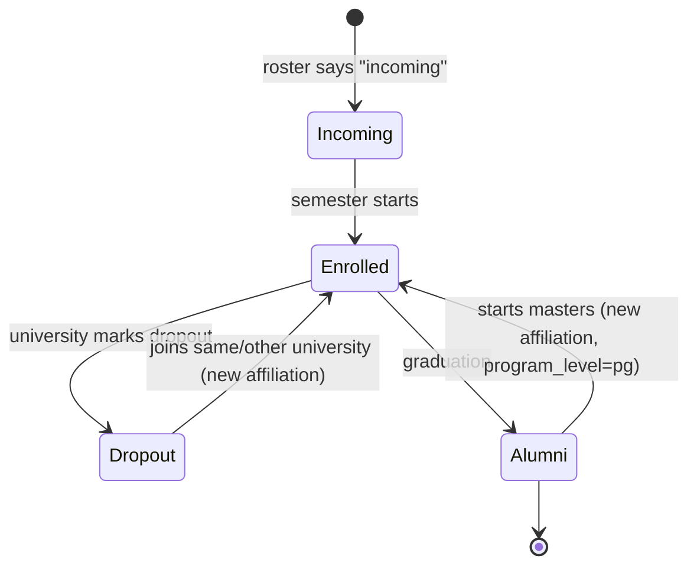
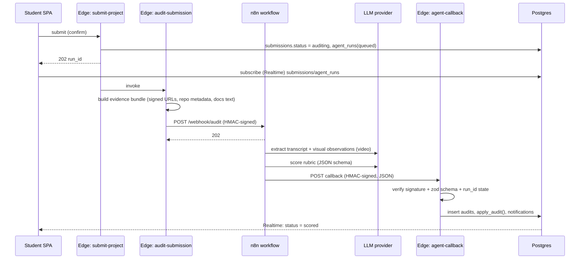

# AptoHire — Architecture

> Companion to [prd.md](./prd.md) and [features.md](./features.md). Agent contracts: [agent.md](./agent.md).
> Scope: **prototype / demo**, built on free tiers, designed so each part can be hardened later.

---

## 1. Principles

1. **One codebase, five hosts.** A single Vite + React app serves `aptohire.com` and four subdomains; the portal is chosen from the hostname.
2. **The database is the security boundary.** Every table has Row-Level Security. The browser only ever holds the anon key and the user's JWT.
3. **AI proposes, rules decide.** AI does the first-pass audit, project suggestions, JD reading, and wording. Identity, consent, permissions, and verification status are rule-based code and SQL.
4. **Every AI step has a fallback.** `mock` mode (deterministic) and `direct` mode (Edge Function → LLM) exist beside the `n8n` mode, so a demo never depends on one service.
5. **Blind by construction.** Organizations query projections that do not contain identity columns; identity is joined only after a consent grant.
6. **Free-tier friendly.** Small files, capped uploads, cached AI results, per-user quotas, keep-alive.

---

## 2. System overview



---

## 3. Domains, portals, routing

### 3.1 Hosts

| Host | Portal key | Contents |
|------|-----------|----------|
| `aptohire.com` | `root` | Marketing, pricing, sign-up chooser, `/verify/:id`, legal |
| `student.aptohire.com` | `student` | Student portal |
| `university.aptohire.com` | `university` | University portal |
| `organization.aptohire.com` | `organization` | Organization portal |
| `admin.aptohire.com` | `admin` | Admin console |

All hosts are attached to **one Vercel project**; one build, one deploy. `vercel.json` rewrites every path to `index.html`.

### 3.2 Portal resolution (`src/lib/portal.ts`)

Resolution order (first match wins):

1. **Hostname** — `student.*`, `university.*`, `organization.*`, `admin.*`, else `root`.
2. **Env override** `VITE_FORCE_PORTAL` (dev/demo only).
3. **Path prefix** — `/student/*`, `/university/*`, `/organization/*`, `/admin/*` (works on free `*.vercel.app` URLs before the domain is purchased).
4. Local dev: `student.localhost:5173` etc. (modern browsers resolve `*.localhost` to loopback).

```ts
export type Portal = 'root' | 'student' | 'university' | 'organization' | 'admin';

export function resolvePortal(loc = window.location): Portal {
  const sub = loc.hostname.split('.')[0];
  if (['student', 'university', 'organization', 'admin'].includes(sub)) return sub as Portal;
  const forced = import.meta.env.VITE_FORCE_PORTAL as Portal | undefined;
  if (forced) return forced;
  const seg = loc.pathname.split('/')[1];
  if (['student', 'university', 'organization', 'admin'].includes(seg)) return seg as Portal;
  return 'root';
}
```

The router mounts exactly one portal tree (`React.lazy` per portal) so a student never downloads organization code.

### 3.3 Sessions across subdomains

- Each origin has its **own Supabase session** (`storageKey: 'aptohire-<portal>'`). There is **no shared cookie** across subdomains: simpler, and a stolen student session cannot open the admin portal.
- Each portal has its **own login page**. The root site only links to them.
- A role guard checks `profiles.role === portal` after login; mismatch → "Go to your portal" screen (F-ID-03).
- Public verification (`/verify/:id`) is on the root and needs no session.

### 3.4 Security headers (Vercel `headers`)

`Content-Security-Policy` (self + Supabase project URL + Google Fonts), `X-Content-Type-Options: nosniff`, `Referrer-Policy: strict-origin-when-cross-origin`, `Permissions-Policy` (camera/mic only where recording is offered), `X-Frame-Options: DENY`.

---

## 4. Tech stack

| Layer | Choice | Notes |
|-------|--------|-------|
| Frontend | **Vite + React 18 + TypeScript** | SPA |
| Routing | React Router | Per-portal route trees |
| Data | **TanStack Query** + `@supabase/supabase-js` | Cache, optimistic updates |
| Forms | React Hook Form + **Zod** | Same Zod schemas shared with Edge Functions |
| Styling | **Tailwind CSS** + CSS variables (tokens in design.md) + **shadcn/ui** (Radix) | |
| Charts / graph | Recharts (analytics), `d3-force` (skill graph) | |
| Motion | Framer Motion (sparingly) | One orchestrated moment: score reveal |
| PDF resume | `@react-pdf/renderer` + `qrcode` | Client-side generation |
| Backend | **Supabase**: Postgres, Auth, Storage, Realtime, Edge Functions (Deno) | |
| Vector | **pgvector** (HNSW index) | Embeddings of scrubbed candidate summaries and job descriptions |
| Agent builder | **n8n** (self-hosted, community edition) | Optional; behind adapter |
| LLM | Gemini Flash-class (default) → Groq → OpenRouter free models | Model names via env, never hard-coded |
| Hosting | **Vercel** (frontend) · Supabase cloud (backend) · small always-on host for n8n | |
| CI | GitHub Actions | lint, typecheck, unit, RLS tests, e2e |
| Dev tooling | Supabase CLI + local Docker stack, MCP servers on **dev projects only**, read-only | |

> **Hosting note.** Vercel Hobby is fine for a non-commercial demo. Before charging anyone or running a company pilot, move to Vercel Pro or another host.

---

## 5. Repository layout

```
aptohire/
├─ docs/                      # prd.md, features.md, architecture.md, design.md, agent.md
├─ src/
│  ├─ main.tsx
│  ├─ app/                    # providers, router, portal resolver, error boundary
│  ├─ portals/
│  │  ├─ root/                # marketing, verify, legal
│  │  ├─ student/
│  │  ├─ university/
│  │  ├─ organization/
│  │  └─ admin/
│  ├─ features/               # shared feature modules (UI + hooks)
│  │  ├─ auth/ profile/ projects/ submissions/ scorecard/ skillgraph/
│  │  ├─ jobs/ matching/ access/ roster/ analytics/ tickets/ notifications/
│  ├─ components/ui/          # shadcn primitives + design-system components
│  ├─ lib/                    # supabase.ts, portal.ts, env.ts, format.ts, schemas/ (zod)
│  └─ styles/                 # tokens.css, globals.css
├─ supabase/
│  ├─ config.toml
│  ├─ migrations/             # 0001_schema.sql … rls_visibility.sql, views, functions
│  ├─ tests/                  # pgTAP RLS tests
│  ├─ seed.sql
│  └─ functions/
│     ├─ _shared/             # auth.ts, hmac.ts, zod schemas, agents/ (adapter, mock, direct, n8n, providers)
│     ├─ register-student/ confirm-affiliation/ roster-import/
│     ├─ assign-project/ submit-project/ audit-submission/ agent-callback/
│     ├─ extract-job-skills/ match-job/ request-access/ respond-access/ withdraw-access/ reveal-student/
│     ├─ public-verify/ profile-sync/ keep-alive/
│     └─ admin-approve-university/ admin-approve-org/ admin-decide-ticket/ admin-review-audit/ admin-seed-reset/
├─ n8n/
│  ├─ docker-compose.yml
│  └─ workflows/              # audit.json, assign.json, match.json, profile.json (exported)
├─ e2e/                       # Playwright: demo script
├─ vercel.json
└─ .env.example
```

---

## 6. Data model

> Names are prescriptive; types abbreviated. Every table: `id uuid pk default gen_random_uuid()`, `created_at timestamptz default now()` unless noted. **RLS enabled on all.**

### 6.1 Entity relationship (core)



### 6.2 Identity and affiliation

```sql
create type app_role as enum ('student','university','organization','admin');

-- one row per auth user; role is set only by trusted server code
create table profiles (
  id uuid primary key references auth.users on delete cascade,
  role app_role not null,
  display_name text,
  created_at timestamptz default now()
);

-- the PERMANENT person record (separate from login and from affiliations)
create table students (
  id uuid primary key default gen_random_uuid(),
  user_id uuid unique references auth.users on delete set null,   -- null until claimed
  full_name text not null,
  primary_email citext,
  photo_path text, headline text, bio text,
  links jsonb default '{}',
  visibility jsonb default '{"public_verify":["skills","levels"],"discoverable":true}',
  credential_id text unique default encode(gen_random_bytes(9),'hex'),  -- public verify id
  created_at timestamptz default now()
);

create type uni_status as enum ('pending','approved','rejected','unregistered');
create table universities (
  id uuid primary key default gen_random_uuid(),
  name text not null, short_name text,
  tier text check (tier in ('tier1','tier2','tier3','other')),
  kind text,                           -- 'university' | 'college' | 'school'
  city text, state text,
  email_domains text[] default '{}',   -- e.g. {'unia.edu.test'}
  status uni_status not null default 'pending',
  approved_at timestamptz,
  created_at timestamptz default now()
);
create table university_members (
  university_id uuid references universities on delete cascade,
  user_id uuid references auth.users on delete cascade,
  member_role text default 'tpo',
  primary key (university_id, user_id)
);

create type life_status as enum ('incoming','enrolled','dropout','alumni');
create type verify_level as enum ('roster','student_id','unverified');

-- university-owned roster (platform never edits the university's master record)
create table roster_entries (
  id uuid primary key default gen_random_uuid(),
  university_id uuid not null references universities on delete cascade,
  full_name text not null, email citext,
  student_id_hash text,                 -- HMAC(pepper, normalized id); never the raw id
  program text, program_level text default 'ug',   -- 'ug' | 'pg'
  year int, status life_status default 'enrolled',
  claimed_student_id uuid references students,
  unique (university_id, student_id_hash)
);

-- platform-owned link between a person and a university (history preserved)
create table affiliations (
  id uuid primary key default gen_random_uuid(),
  student_id uuid not null references students on delete cascade,
  university_id uuid references universities,        -- null if unregistered
  university_name_text text,                         -- for unregistered universities
  program_level text default 'ug',
  status life_status not null,
  year int,
  verification verify_level not null default 'unverified',
  roster_entry_id uuid references roster_entries,
  is_current boolean default true,
  started_on date, ended_on date,
  created_at timestamptz default now()
);
create unique index one_current_affiliation on affiliations(student_id) where is_current;
```

### 6.3 Skills, projects, audits

```sql
create table skills (
  id uuid primary key default gen_random_uuid(),
  slug text unique not null, name text not null, family text not null, description text
);
create table skill_edges (a uuid references skills, b uuid references skills, weight real, primary key(a,b));

create table project_templates (
  id uuid primary key default gen_random_uuid(),
  family text not null, title text not null, level text not null,
  brief jsonb not null,              -- scenario, deliverables, constraints, variation slots
  rubric jsonb not null,             -- criteria, weights, evidence expectations
  active boolean default true
);
create table project_assignments (
  id uuid primary key default gen_random_uuid(),
  student_id uuid not null references students on delete cascade,
  template_id uuid references project_templates,
  target_skills uuid[] not null, level text,
  brief jsonb not null,              -- the personalised brief shown to the student
  fingerprint text,                  -- for similarity checks
  status text default 'assigned',
  created_at timestamptz default now()
);

create type submission_status as enum
  ('draft','submitted','auditing','scored','needs_review','appealed','failed');
create table submissions (
  id uuid primary key default gen_random_uuid(),
  student_id uuid not null references students on delete cascade,
  assignment_id uuid references project_assignments,
  title text not null, description text,
  skills_claimed uuid[] not null,
  video_path text, video_url text,                  -- upload path or unlisted link
  doc_paths text[] default '{}',
  live_url text, github_url text,
  ai_use jsonb,                                     -- {used: bool, tools: [], notes: ''}
  status submission_status default 'draft',
  submitted_at timestamptz, created_at timestamptz default now()
);

create type agent_kind as enum ('audit','assign','match','jd_extract','profile');
create table agent_runs (
  id uuid primary key default gen_random_uuid(),
  kind agent_kind not null, mode text not null,     -- mock | direct | n8n
  subject_type text, subject_id uuid,
  status text default 'queued',                     -- queued|running|succeeded|failed|timeout
  input_hash text, tokens_est int, latency_ms int, error text,
  started_at timestamptz default now(), finished_at timestamptz
);

create table audits (
  id uuid primary key default gen_random_uuid(),
  submission_id uuid not null references submissions on delete cascade,
  run_id uuid references agent_runs,
  rubric_version text not null,
  prompt_version text not null,    -- e.g. 'audit@3' (see agent.md B2.2)
  flags text[] default '{}',       -- e.g. {'inconsistent_claims'}; routes to human review
  per_skill jsonb not null,        -- [{skill_id, score, criteria:[{name,score,weight,rationale,evidence_ref}]}]
  overall int not null,
  summary text not null,
  confidence real not null,        -- 0..1
  evidence jsonb not null,         -- [{ref, kind, label, pointer}]  (pointer: file/path/timestamp)
  borderline boolean default false,
  review_status text default 'none',   -- none|pending|confirmed|adjusted
  reviewed_by uuid references auth.users, reviewed_at timestamptz,
  created_at timestamptz default now()
);

create table skill_scores (
  student_id uuid references students on delete cascade,
  skill_id uuid references skills,
  score int not null, level text not null, verified boolean not null,
  confidence real, best_audit_id uuid references audits,
  updated_at timestamptz default now(),
  primary key (student_id, skill_id)
);
create table skill_score_history (
  id uuid primary key default gen_random_uuid(),
  student_id uuid, skill_id uuid, score int, audit_id uuid, created_at timestamptz default now()
);
```

**Scoring rules (SQL function `apply_audit(audit_id)`):**
`verified = score > PASS_MARK`; level = Emerging ≤ 50 < Competent ≤ 69 < Proficient ≤ 84 < Advanced; a student's `skill_scores.score` = latest *final* audit score, or a confidence-weighted blend of the last N audits (config); `borderline = score BETWEEN 40 AND 60` → `review_status='pending'` and the result shows "Under human review" until an admin confirms (a borderline result still displays, but is not shared with organizations until confirmed).

### 6.4 Profile sources, credentials, tickets

```sql
create table profile_sources (
  id uuid primary key default gen_random_uuid(),
  student_id uuid references students on delete cascade,
  kind text check (kind in ('github','linkedin_export','manual')),
  consent boolean not null default false, consent_at timestamptz, revoked_at timestamptz,
  token_secret_id uuid,             -- reference to Supabase Vault secret (never raw token in table)
  data jsonb, last_synced_at timestamptz
);
create table tickets (
  id uuid primary key default gen_random_uuid(),
  student_id uuid references students, submission_id uuid references submissions,
  reason text not null, status text default 'open',         -- open|ack|in_review|decided
  assigned_to uuid references auth.users, ack_at timestamptz,
  decision text, decision_note text, decided_at timestamptz
);
```

### 6.5 Organizations, jobs, blind matching, consent

```sql
create table organizations (
  id uuid primary key default gen_random_uuid(),
  name text not null, size text, kind text, website text,
  status text default 'pending',                -- pending|approved|rejected
  subscription_status text default 'inactive',  -- admin-toggled in prototype
  verified_at timestamptz
);
create table organization_members (
  organization_id uuid references organizations on delete cascade,
  user_id uuid references auth.users on delete cascade,
  member_role text default 'recruiter', primary key (organization_id, user_id)
);
create table jobs (
  id uuid primary key default gen_random_uuid(),
  organization_id uuid not null references organizations on delete cascade,
  title text not null, description text,
  required_skills jsonb not null,               -- [{skill_id, min_level, weight}]
  mode text, location text, openings int default 1,
  status text default 'open',
  embedding vector(768),                        -- dimension from EMBEDDING_DIM env
  created_at timestamptz default now()
);

-- BLIND PROJECTION: contains no identity fields, built by a trusted function
create table candidate_profiles (
  student_id uuid primary key references students on delete cascade,
  uni_category text,                            -- e.g. 'Tier 2 · State university'
  skills jsonb not null,                        -- [{skill_id, score, level, verified}]
  scrubbed_summary text,                        -- PII-scrubbed evidence summary
  study_stage text,                             -- 'year 2' | 'alumni' ... (bucketed)
  project_count int, discoverable boolean default true,
  embedding vector(768), updated_at timestamptz default now()
);
create index on candidate_profiles using hnsw (embedding vector_cosine_ops);

create table match_results (
  id uuid primary key default gen_random_uuid(),   -- opaque 'candidate ref' used by organizations
  job_id uuid not null references jobs on delete cascade,
  student_id uuid not null references students,    -- NEVER exposed to organizations
  alias text not null,                             -- 'Candidate K7F2' = HMAC(job_id||student_id)
  structured_score real, vector_score real, final_score real, confidence real,
  reasons jsonb, gaps jsonb, created_at timestamptz default now(),
  unique (job_id, student_id)
);

create table access_requests (
  id uuid primary key default gen_random_uuid(),
  organization_id uuid not null references organizations,
  job_id uuid references jobs,
  match_result_id uuid references match_results,
  student_id uuid not null references students,
  message text, requested_scope text[] not null,    -- profile|scorecard|projects|contact
  duration_days int default 30,
  status text default 'pending',                    -- pending|accepted|declined|withdrawn|expired
  granted_scope text[], expires_at timestamptz, responded_at timestamptz
);
create table feedback (
  id uuid primary key default gen_random_uuid(),
  organization_id uuid, student_id uuid, job_id uuid,
  option_codes text[] not null, note text check (char_length(note) <= 280)
);
create table demand_signals (          -- university-facing, no identities
  id uuid primary key default gen_random_uuid(),
  job_id uuid references jobs, university_id uuid references universities,
  skill_ids uuid[], reason_counts jsonb       -- {no_eligible:3, incomplete:5, opted_out:1, ...}
);
```

### 6.6 System tables

```sql
create table notifications (id uuid primary key default gen_random_uuid(), user_id uuid not null,
  kind text, payload jsonb, read_at timestamptz, created_at timestamptz default now());
create table audit_log (id uuid primary key default gen_random_uuid(), actor_id uuid, actor_role app_role,
  action text not null, subject_type text, subject_id uuid, meta jsonb, created_at timestamptz default now());
create table app_config (key text primary key, value jsonb not null);
-- seeds: PASS_MARK=50, BORDERLINE=[40,60], AGENT_MODE='mock', REQUIRE_VIDEO=true,
--        AI_DAILY_CAP_PER_USER=5, AI_KILL_SWITCH=false
```

---

## 7. Authorization (RLS)

### 7.1 Helper functions (`security definer`, `stable`, `set search_path = ''`)

`current_role()`, `is_admin()`, `my_student_id()`, `my_university_ids()`, `my_org_ids()`, `student_in_my_university(student_id)` (via a *current or past* affiliation to one of my universities with `roster`/`student_id` verification), `has_active_grant(org_id, student_id, scope)`.

### 7.2 Policy matrix (per spec)

| Table / view | Student | University | Organization | Admin |
|---|---|---|---|---|
| `students` | own row | rows of own students (limited columns via view) | **none** (only via `org_revealed_students` after grant) | all |
| `affiliations` | own | own university's | none | all |
| `roster_entries` | none | own university: full CRUD | none | all |
| `submissions`, `audits`, `skill_scores` | own | own students (files only if student consent flag) | none (summary only via blind view; evidence via reveal) | all |
| `candidate_profiles` | own | none | **none directly** | all |
| `match_results` | none | none | **none directly** — use `org_candidate_cards` view | all |
| `org_candidate_cards` (view) | — | — | own jobs' candidates, blind columns only | all |
| `org_revealed_students` (view) | — | — | only rows with active grant, columns per `granted_scope` | all |
| `universities` | public columns of all | own (edit), others: public columns only | **all universities (public columns)** | all |
| `organizations`, `jobs` | public columns | **all organizations and jobs** | **all organizations** (as per spec); own jobs full | all |
| `access_requests` | own | none | own organization's (student identity masked until accepted) | all |
| `demand_signals` | none | own university | none | all |
| `tickets` | own | none | none | all |
| `audit_log` | none | none | none | read-only all |

> **Isolated on purpose:** university↔organization and organization↔organization visibility is implemented in **one migration file** (`rls_visibility.sql`) so tightening it later (e.g. hiding competitor job posts) is a single change.

### 7.3 Blind views (the gate)

Supabase views run with the owner's privileges by default, so the **view's own `WHERE`** is the gate:

```sql
create view org_candidate_cards as
select m.id as candidate_ref, m.job_id, m.alias, m.final_score, m.confidence, m.reasons, m.gaps,
       c.uni_category, c.skills, c.study_stage, c.project_count
from match_results m
join candidate_profiles c using (student_id)
join jobs j on j.id = m.job_id
where j.organization_id = any (my_org_ids());      -- no student_id, name, email, photo, university name

create view org_revealed_students as
select ar.organization_id, ar.job_id,
       case when 'profile' = any(ar.granted_scope) then s.full_name end as full_name,
       case when 'profile' = any(ar.granted_scope) then s.headline end as headline,
       case when 'contact' = any(ar.granted_scope) then s.primary_email end as email,
       s.id as student_id, ar.expires_at
from access_requests ar join students s on s.id = ar.student_id
where ar.status = 'accepted' and ar.expires_at > now()
  and ar.organization_id = any (my_org_ids());
```

Files (resume, videos, documents) are **never** exposed through Storage policies to organizations; the `reveal-student` Edge Function returns **short-lived signed URLs** for granted scopes and writes `audit_log`.

### 7.4 Policy tests (pgTAP, in CI)

For every row in the matrix above, a test impersonates each role (`set local role authenticated; set local request.jwt.claims ...`) and asserts allowed/denied counts. Required negative tests:

- Student A cannot read Student B's `students`, `submissions`, `skill_scores`.
- University A cannot read Uni B's `roster_entries`, `affiliations`, or students.
- Organization **cannot** read `students`, `match_results`, `candidate_profiles`, `affiliations` directly.
- `org_candidate_cards` returns **zero** identity columns (checked by column list and by value scan).
- Reveal fields disappear after `withdrawn` / `expired`.
- A user cannot set or change their own `profiles.role`.

---

## 8. Auth and sessions

- **Supabase Auth**, email + password (OTP optional), GitHub OAuth only for **connecting a source** (not for login).
- **Role assignment is server-side**: the client signs up, then calls `complete-signup({portal})`, which accepts only `student | university | organization` and sets `profiles.role` once. `admin` is created manually. Clients cannot write `profiles.role` (no policy).
- Optional Auth Hook adds `role` to the JWT for cheaper policies.
- Session: short JWT expiry, refresh-token rotation on, "sign out everywhere", MFA (TOTP) required for admin.
- Separate sessions per portal origin (§3.3).
- **Email change** requires verification of the new address.
- **Demo switcher** (F-ID-07) exists only when `VITE_DEMO_MODE=true`; it logs in using seeded demo credentials and is excluded from production builds.

---

## 9. Student identity lifecycle (no double entry)

**Principle:** one permanent `students` row; logins and universities attach to it.



**Algorithm `register-student` / `confirm-affiliation`:**

1. **Detect:** email domain ∈ approved `universities.email_domains` → look up `roster_entries` by email → *roster* verification. Otherwise, if the student supplies a student ID + university → hash and look up → *student_id* verification. Otherwise → *unverified* affiliation with `university_name_text`.
2. **Find the person:** match an existing `students` row by verified email or `student_id_hash`. If found, **do not create a new person**; propose "confirm new affiliation".
3. **Confirm:** on confirm, close the current affiliation (`is_current=false`, `ended_on`, status set to alumni/dropout as appropriate) and open a new one. `skill_scores`, `submissions`, `credential_id` are untouched.
4. **Login ownership:** a login can be moved to a new email only with verification of that email. A roster-matched university email can *add* a verification level, never take over an existing login.
5. **Unregistered university:** affiliation `unverified`; **no effect on scores, discoverability, or matches** (verification badge differs only).
6. **University updates its roster** (e.g., marks Avi as alumnus) → platform updates **its own** `affiliations` row for that roster link; the university's master roster remains the university's.

---

## 10. Storage

| Bucket | Visibility | Path pattern | Rules |
|---|---|---|---|
| `videos` | private | `{student_id}/{submission_id}/demo.{ext}` | mp4/webm/mov, ≤ `VIDEO_MAX_MB` (default 50), ≤ 3:10; owner write/read; admin read; agents read via **short-lived signed URL** (10 min) |
| `documents` | private | `{student_id}/{submission_id}/{name}` | pdf/docx/md/zip, ≤ 20 MB |
| `rosters` | private | `{university_id}/{ts}.csv` | university members only; deleted after processing (kept: hashed rows) |
| `avatars` | private, signed | `{student_id}.jpg` | ≤ 1 MB |
| `resumes` | private | `{student_id}/resume.pdf` | optional cache |

Retention (configurable): drafts deleted after 30 days; raw videos deleted after 90 days (transcript, scores, evidence pointers stay); no ID-card images are ever stored.

**Free-tier budget:** with ~1 GB storage and 50 MB cap, only a few dozen real videos fit. Seeded demo audits therefore reference **one small shared sample video** and pre-computed evidence; `mock` mode needs no stored video.

---

## 11. Edge Functions (API)

All functions: Deno, Zod-validated input, `Authorization: Bearer <JWT>` (except callback and public-verify), CORS restricted to the five hosts, rate-limited, structured error `{error:{code,message}}`.

| Function | Caller | Purpose |
|---|---|---|
| `complete-signup` | any new user | Set role once from portal |
| `register-student` | student | Detect university/roster, find-or-create person, create affiliation |
| `confirm-affiliation` | student | Accept new affiliation (lifecycle step 3) |
| `roster-import` | university | Validate rows, hash IDs, upsert roster, return validation report |
| `assign-project` | student | Project Assigner agent → `project_assignments` |
| `submit-project` | student | Validate completeness (video rule), freeze submission, create `agent_runs`, invoke audit |
| `audit-submission` | internal | Build evidence bundle → agent adapter |
| `agent-callback` | n8n (HMAC) | Verify signature, validate JSON against schema, write `audits`, run `apply_audit`, notify |
| `extract-job-skills` | organization | JD → skills/levels (agent) |
| `match-job` | organization / internal | Rank candidates, write `match_results`, compute `demand_signals` |
| `request-access` | organization | Create request, notify student |
| `respond-access` | student | Accept (with scope + duration) / decline |
| `withdraw-access` | student | Revoke grant |
| `reveal-student` | organization | Return granted data + signed URLs; audit-log each call |
| `public-verify` | anonymous | Return credential page data per student visibility (rate-limited, cached) |
| `profile-sync` | student / cron | GitHub fetch (read-only), LinkedIn export parse, profile proposals |
| `admin-*` | admin (MFA) | Approvals, ticket decisions, audit review, seed/reset (non-prod only) |
| `keep-alive` | cron | Touch DB + log; export snapshot |

### 11.1 Example contract: `submit-project`

```jsonc
// POST /functions/v1/submit-project
{
  "submission_id": "uuid",
  "confirm": true               // student confirms AI-use disclosure and consent to AI review
}
// 202
{ "run_id": "uuid", "status": "queued", "mode": "n8n" }
// 422 examples: VIDEO_REQUIRED, VIDEO_TOO_LONG, MISSING_SKILLS, QUOTA_EXCEEDED, KILL_SWITCH
```

---

## 12. Agent orchestration

### 12.1 Adapter

`supabase/functions/_shared/agents/adapter.ts` exposes one interface per agent kind; `AGENT_MODE` (from `app_config`, overridable per run by admin) selects:

| Mode | Behavior | Use |
|---|---|---|
| `mock` | Deterministic, schema-valid result seeded by `hash(input)`; realistic rationale text from templates; 1–3 s delay | Offline demos, tests, CI |
| `direct` | Edge Function calls the LLM provider directly with the same prompts and JSON schema | Default fallback; no n8n needed |
| `n8n` | Edge Function posts a signed job to n8n; n8n calls LLMs and posts a signed callback | Visual workflow builder showcase |

If `n8n` fails to ACK within 5 s or no callback arrives within the timeout (default 8 min), the run is retried once in `direct`; if that fails → `mock` is **not** used silently for real students (it is for demo accounts only); the run is marked `failed` and the student sees "We couldn't finish the review. Retry" with a one-tap retry.

### 12.2 Audit sequence (n8n mode)



### 12.3 Webhook security (n8n ⇄ platform)

- Request header: `X-Aptohire-Timestamp` (epoch s), `X-Aptohire-Signature: sha256=<hex HMAC(secret, ts + "." + rawBody)>`; reject if `|now − ts| > 300 s` or run already finished (replay protection).
- n8n holds **only**: `CALLBACK_SECRET`, LLM API keys. **It never receives the database URL, service-role key, or user JWTs.** Media access is by 10-minute signed URLs in the payload.
- The callback payload is validated against a Zod schema; unknown fields are dropped; scores clamped to 0–100; every `evidence_ref` must exist in the bundle that was sent (prevents fabricated evidence).
- Prompts treat all student content (video transcript, README, documents) as **untrusted data**; see agent.md §2.3 on prompt-injection handling.

### 12.4 Evidence bundle (what the audit engine receives)

```jsonc
{
  "run_id": "uuid", "rubric_version": "web-frontend@1",
  "submission": { "title": "", "description": "", "skills_claimed": ["react","typescript"], "ai_use": {...} },
  "rubric": { "criteria": [ {"name":"Correctness","weight":0.25}, ... ] },
  "media": { "video_signed_url": "https://…", "video_seconds": 172 },
  "documents": [ { "name": "design.md", "text": "…", "pointer": "doc:design.md" } ],
  "repo": { "url": "https://github.com/…", "readme": "…", "tree": ["src/…"], "languages": {…},
            "commit_stats": {"count": 41, "first": "…", "last": "…"}, "tests_present": true },
  "live": { "url": "https://…", "status": 200, "title": "…", "lighthouse": null },
  "originality_questions": [ {"q":"Why did you choose X?"} ]
}
```

The student's name, email, and university are **not** included in the bundle (the audit is blind to identity).

### 12.5 Matching pipeline (`match-job`)

1. **Candidate projection refresh:** after each final audit, rebuild `candidate_profiles` (skills, bucketed stage, scrubbed summary, embedding).
2. **Structured match (primary):** for each job skill *i* with weight *wᵢ* and required level *rᵢ*: `cover = Σ wᵢ·min(1, scoreᵢ / minScoreForLevel(rᵢ))`, only **verified** skills count fully; unverified count 0.5.
3. **Vector rerank (secondary):** cosine similarity between job embedding and candidate embedding via pgvector (HNSW), restricted to candidates passing step 2's coverage floor.
4. **Final:** `final = 0.7·structured + 0.3·vector`; `confidence` from audit confidences, evidence count, and coverage.
5. **Reasons:** deterministic facts first ("Verified React — Proficient (78)"), then an LLM-worded one-liner constrained to those facts.
6. **Alias:** `alias = "Candidate " + base32(HMAC(ALIAS_PEPPER, job_id || student_id))[0:4]` — stable per job, not linkable across jobs.
7. **Demand signals:** if candidates < threshold, compute per-university reason counts (no eligible candidates, incomplete assessments, insufficient evidence, skills mismatch, opted out, available but not assessed) and write `demand_signals`.

**Scrubbing** (before embedding and before any text reaches an organization): remove names, emails, phone numbers, URLs, university and company names, locations, and social handles using deterministic regex plus a roster-name dictionary pass; the LLM is *not* trusted to scrub.

---

## 13. Seed data (fictional)

`supabase/seed.sql` + `admin-seed-reset`. Emails use the reserved `.test` TLD; all passwords are the same demo value (non-production only).

| Entity | Seed |
|---|---|
| Admin | `admin@demo.aptohire.test` |
| Uni A | Tier 2, **approved**, domain `unia.edu.test`; TPO user; roster: Aman (incoming), Ajay (Y1), Aarav (Y2), Akshit (Y3), Aarti (dropout), Avi (alumnus) |
| Uni B | Tier 3, **approved**, no email domain; TPO user; roster with student-ID hashes: Nikhil, Neha, Naman, Naveen, Nita, Niya |
| Uni C | **pending** application; roster pre-uploaded but locked: Sumit, Sourav, Sam, Shiva, Shruti, Sohan |
| Uni D | **not registered** (name text only): Priya (Y2), Adarsh (Y3) with *unverified* affiliations |
| Lifecycle cases | Avi → masters at Uni B · Niya → masters at Uni D (unverified) · Aarti → joins Uni B · Nita → none · Sohan works at Org A, profile auto-maintained from consented source |
| Skills | Web/Frontend family fully seeded with rubrics; other families placeholder |
| Pre-scored students | Aarav (React: Proficient, verified), Akshit (TypeScript: Competent), Naveen (React: borderline 52, pending review), Avi (SQL: Advanced) — evidence from mock audits |
| Organizations | **Org A** (mid-size corporate, subscription active), **Org B** (start-up, active); one recruiter each |
| Jobs | Org A: "Frontend Developer (React)"; Org B: "Junior Full-stack Intern" and one job with **no matches** to trigger a university demand alert |
| Consent states | One pending request, one accepted (with expiry), one declined, one withdrawn |

`admin-seed-reset` is disabled when `APP_ENV=production`.

---

## 14. Environment variables

| Variable | Where | Purpose |
|---|---|---|
| `VITE_SUPABASE_URL`, `VITE_SUPABASE_ANON_KEY` | frontend | Public client config |
| `VITE_APP_ENV` (`local`/`demo`/`production`), `VITE_DEMO_MODE` | frontend | Enables demo switcher |
| `VITE_FORCE_PORTAL` | frontend (dev) | Override portal resolution |
| `VITE_ROOT_DOMAIN` | frontend | `aptohire.com` or `localhost` |
| `SUPABASE_SERVICE_ROLE_KEY` | **Edge Functions only** | Server-side DB access |
| `AGENT_MODE` | config default | `mock` \| `direct` \| `n8n` |
| `N8N_BASE_URL`, `N8N_WEBHOOK_SECRET`, `CALLBACK_SECRET` | Edge Functions / n8n | Signed webhooks |
| `LLM_PROVIDER_ORDER` | Edge Functions | e.g. `gemini,groq,openrouter` |
| `GEMINI_API_KEY`, `GROQ_API_KEY`, `OPENROUTER_API_KEY` | Edge Functions / n8n | Provider keys |
| `LLM_MODEL_*`, `EMBEDDING_MODEL`, `EMBEDDING_DIM` | Edge Functions | Model names (never hard-coded) |
| `ID_HASH_PEPPER`, `ALIAS_PEPPER` | Edge Functions | HMAC secrets for ID hashes and aliases |
| `GITHUB_CLIENT_ID`, `GITHUB_CLIENT_SECRET` | Edge Functions | Read-only OAuth |
| `VIDEO_MAX_MB`, `VIDEO_MAX_SECONDS` | config | Upload limits |
| `APP_ENV` | Edge Functions | Disables seed/reset in production |

`.env.example` is committed; real values are never committed. Only `VITE_*` values reach the browser.

---

## 15. Deployment

| Component | Where | Notes |
|---|---|---|
| Frontend | Vercel (one project, five domains) | Preview URLs use path-prefix portals |
| Backend | Supabase project (separate **dev**, **demo**, later **prod**) | Migrations via CLI in CI |
| n8n | Docker (`n8n/docker-compose.yml`) on an always-on host; locally for dev | Behind HTTPS and basic auth; export workflows to `n8n/workflows/` |
| DNS | `aptohire.com` A/CNAME to Vercel; wildcard-style records for the four subdomains | Verify domain availability first |
| Cron | `pg_cron` / scheduled function: keep-alive (daily), DB export (weekly), expiry of grants (hourly), retention cleanup (daily) | |

**Environments:** `local` (Supabase CLI) → `demo` (shared, seeded, `AGENT_MODE=direct`) → `production` (later). MCP tooling is connected **only** to `local`/`demo` projects with read-only or least-privilege access.

---

## 16. Observability and operations

- `agent_runs` powers the admin monitor (status, mode, latency, estimated tokens, error).
- `audit_log` for reveals, grants, admin actions, ticket decisions.
- Client errors → console + optional Sentry free tier; Edge Function logs via Supabase.
- **Kill switch** (`AI_KILL_SWITCH`) stops all new agent runs; UI shows a calm "Reviews are paused" message.
- **Quotas:** per-user daily agent caps; global daily cap per provider; cache keyed by `input_hash`.

---

## 17. Testing strategy

| Level | Tools | Must cover |
|---|---|---|
| Unit | Vitest | Portal resolver, scoring/level mapping, scrubbing, alias, HMAC verify, Zod schemas |
| DB / RLS | pgTAP | Every policy and view in §7 (positive and negative) |
| Contract | Vitest + mock mode | Agent output schemas; evidence refs must exist in bundle |
| E2E | Playwright | The demo script (prd.md §12) on `*.localhost` hosts |
| Accessibility | axe in Playwright | No serious violations on core screens |
| AI quality | Admin report | AI vs human agreement on a 30-project sample; false-pass rate |

**Definition of done for any feature:** RLS tests added or updated, Zod schema shared, empty/error/loading states built, `features.md` status updated, no secrets in the diff.
